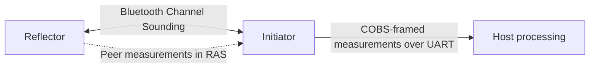

# Architecture

This overview is for contributors who need to understand the firmware's main
parts and how ranging data reaches the host. The firmware runs on Nordic
nRF54L devices using the nRF Connect SDK and Zephyr.

## Firmware roles

A ranging setup consists of two devices:

- The **initiator** acts as a BLE central. It finds and connects to a reflector,
  configures Channel Sounding, collects measurements, and streams them to a
  host over UART.
- The **reflector** acts as a BLE peripheral. It advertises, accepts a connection,
  and participates in Channel Sounding. In RAS builds it also serves its
  measurements through the Bluetooth Ranging Service.

The host consumes the measurement stream for further processing. Distance
estimation belongs downstream of this firmware.

## Code boundaries

| Component | Responsibility |
|-----------|----------------|
| [`initiator/`](../initiator/) | Application startup, measurement delivery, and UART output. |
| [`reflector/`](../reflector/) | Advertising, reflector setup, and ranging-response lifecycle. |
| [`common/`](../common/) | Initiator connection and acquisition flow, measurement parsing, antenna configuration, and stalled-ranging recovery. |
| nRF Connect SDK / Zephyr | Bluetooth services and host APIs, controller integration, scheduling, and hardware drivers. The Nordic controller executes the Channel Sounding procedures. |
| [mars-bluetooth-hci](https://github.com/Metirionic/mars-bluetooth-hci) | Measurement data types and binary serialization, exposed to the C firmware through a Rust C API. |

The initiator links the shared C library and the Rust serializer. The reflector
compiles only the antenna and watchdog sources from `common/` alongside its
application. This keeps acquisition, parsing, and serialization on the initiator.

## Measurement flow

The acquisition path is selected at build time. Both variants produce the same
measurement event format for the host.

**RAS (Ranging Service).** Each device collects its own Channel Sounding step
data. The reflector transfers its data through the GATT Ranging Service. The
initiator matches local and peer subevents, parses their measurements, and emits
an event for each device. Peer data can arrive through realtime notifications
or an on-demand request, depending on the reflector's capabilities.

**IPT (Inline PCT Transfer).** The reflector's phase contribution is
included in the initiator's local tone measurements, removing the peer-data
transfer through RAS. The initiator parses its local data and creates a
compatible peer event with an identity phase correction. The reflector leaves
Channel Sounding setup to the initiator.

After parsing, the initiator passes the events to the Rust serializer and sends
the COBS-framed bytes over the configured UART. The host decoder must match the
wire-format version of the pinned `mars-bluetooth-hci` dependency.

## Execution and recovery

The initiator completes connection and Channel Sounding setup before the
controller runs recurring procedures. Bluetooth callbacks deliver measurement
data to the firmware.

In **RAS**, parsing and serialization run in the ranging-data callback. Waiting
for UART transmission can therefore delay Bluetooth reception.

In **IPT**, the Bluetooth receive thread parses and prepares an event pair, then
hands it to the main thread for serialization and UART transmission. If the
previous pair is still being sent, the incoming procedure is dropped and
counted. This bounds memory use and keeps UART waits out of the receive thread.

Both roles monitor ranging progress with a watchdog and recover stalled ranging
by disconnecting, with a reboot fallback. The initiator also bounds setup waits
and reboots after setup failure; scanning can wait indefinitely for a peer.

## Build and hardware configuration

Each application has CMake presets that select the board, devicetree overlay,
and Kconfig fragments. These define three aspects of a firmware build:

- **Role:** initiator or reflector.
- **Acquisition:** RAS or IPT, selected by `CONFIG_MARS_CS_INLINE_PCT`.
- **Hardware:** UART routing, antenna switching, and antenna/path limits.

Antenna configuration combines the local build settings with the peer's
negotiated antenna capabilities. The Nordic controller owns antenna switching.

See [hardware configuration](hardware.md) for supported boards and presets,
[building from source](build-from-source.md) for build instructions, and the
[flash quickstart](flash-quickstart.md) for installing prebuilt firmware.
